# Two packet decodings

Why client 03040008 has two decoded forms of the same captures, what each is good for and what to do when they disagree, for anyone reading `packets/decrypted_annotated/` or `packets/decrypted_json/`. In short: the annotated dumps rest on the server CLI's knowledge, the JSON on raw understanding and inference from the binaries. So the annotated dumps have figured out more through play, and may still hold wrong orders or sizes that need checking. Read the [glossary](../reference/glossary.md#packets) first; [Evidence model](evidence-model.md) has the wider reasoning. The examples were checked on 2026-11-04.

## How each is produced

The question this diagram answers is what each decoded form depends on; an arrow means "is made from".

```mermaid
flowchart TD
    A[encrypted streams] --> B[patched Arrowgene.Ddon.Cli]
    C[server PacketStructure C#] --> B
    B --> D[decrypted_annotated: text dumps]
    B --> E[decrypted_raw: one file per packet]
    E --> F[plbatch]
    G[patterns/03040008] --> F
    H[PC client code in IDA] --> G
    F --> I[decrypted_json: one file per packet]
```



- **Annotated:** `Arrowgene.Ddon.Cli` decrypts a stream and runs the server emulator's `PacketStructure` C# over each packet, with the patches [Arrowgene CLI patches](../reference/arrowgene-cli-patches.md) lists. Those structures are the ones the server emulator uses to talk to a real client. The captures themselves are of the official server, so the dump is the emulator's reading of someone else's bytes.
- **JSON:** the patterns under `packets/patterns/03040008/`, written from the client's readers and writers, run through plbatch over the raw files.

The two share their decryption and differ in everything after it. The raw files themselves come from the patched CLI, so a CLI error in framing would reach both, but its structures reach only the annotated dumps.

## What each is strong and weak on

| | Annotated dump | JSON |
| --- | --- | --- |
| Rests on | people playing against the client | the code of the client |
| Strong on | meaning: names, enums, what a value does in play | sizes and order, where a reader exists |
| Weak on | order of same-width fields, fields it never needs, packets with no structure | meaning: a field the code only stores stays `unk_*` or `G` |
| Says where it stops | no: a wrong name reads like a right one | yes: every field carries a [mark](../reference/glossary.md#evidence-marks) |
| Form | one text dump per stream, with a hex dump and a `StructDump` line per packet | one JSON file per packet, with `fits` |

The server's test is whether the client accepts its packets. That test finds wrong meanings fast, since a wrong enum shows up on the screen. It does not find a swapped pair of fields the server only ever writes back, nor a field the client ignores. The patterns have the opposite exposure: the reader settles the bytes and may say nothing about what they do.

## When they disagree

- **Size and order: the PC code decides.** A server layout the PC reader or writer contradicts is a server error, and it gets reported. It does not change the pattern.
- **Meaning: a server name tested by play is a strong lead.** It may raise a field's name to `G (lead)`, or, with a stated basis from code, values or hints, to `I (<basis>; lead agrees)`. A contradiction between the server's name and the code's is recorded in the pattern's comment.

A peer might ask for one merged decoding. It would have to choose per field, and that choice is exactly what the marks record; keeping both forms lets a later reader see what each said. Rates of agreement over a batch of ids are on [Status](../reference/status.md#the-two-packet-decodings), with the measurement behind them.

## The two agree

14.3.2 `S2C_WARP_WARP_RES`, pcap packet 12863 of stream3 tcp-stream-47. The same bytes are the walk of [Read one packet by hand](../tutorials/read-one-packet.md).

```text
packets/decrypted_annotated/stream3-party-experiments-marked.pcapng_tcp-stream-47.yaml.annotated.txt, pcap packet 12863:
StructDump: {"Structure": {"WarpPointId": 66, "Rim": 39109, "Error": 0, "Result": 0}}

packets/decrypted_json/stream3-party-experiments-marked.pcapng_tcp-stream-47/12863_S2C_WARP_WARP_RES_2019-07-08T10_35_53.3199119-07_00.14_3_2.json:
{"packet":{"group":14,"id":3,"subId":2,"source":52,"packetcounter":0,"sourceOk":true,"Error":0,"Result":0,"WarpPointID":66,"Rim":39109,"paddingSize":7,"fits":true}}
```

Same fields, same values. The agreement is corroboration, and the layout still rests on PC reader `0x81dc00`.

## They differ in layout, and the code decides

19.28.2 `S2C_SKILL_GET_CURRENT_SET_SKILL_LIST_RES`, pcap packet 10274 of stream31 tcp-stream-13. The first list element's bytes are `0a | 00 00 00 01 | 00 00 00 02 | 00 00 00 00`.

```text
packets/decrypted_annotated/stream31-loginfail-marked.pcapng_tcp-stream-13.yaml.annotated.txt, pcap packet 10274, first element of NormalSkillList:
{"Job": "SpiritLancer", "Index": 1, "SkillNo": 2, "PreSkillNo": 0}

packets/decrypted_json/stream31-loginfail-marked.pcapng_tcp-stream-13/10274_S2C_SKILL_GET_CURRENT_SET_SKILL_LIST_RES_2019-08-08T10_46_51.5785350-07_00.19_28_2.json, .packet.NormalSkillList.entries[0]:
{"Job":10,"SkillNo":1,"Index":2,"PreSkillNo":0}
```

The server's `CDataNormalSkillParam.cs` reads Index before SkillNo. PC list reader `0x76f820` fills a `0x14`-byte object: a vtable, a u8 at `+4`, and the three u32 at `+8`, `+0xc` and `+0x10`. PS4 reader `0x19f1cc0` stores them at `+0xc`, `+0x10` and `+0x14`, and the PS4 02020005 DWARF members and the recompilation's `Skill.h` name those SkillNo, Index and PreSkillNo in that order (`specs/006-packet-pattern-coverage/research/T012-achievement-equip-skill.md` § 20). The code decides, and the pattern's `include/Skill.hexpat` says so with the server's order as a lead. A fit could not have settled this: the two orders are the same bytes. Note that the annotated side still gives `SpiritLancer` for the job, which the JSON leaves as 10.

Sizes differ the same way. 14.11.16 `C2S_WARP_14_11_16_NTC`, pcap packet 10361 of the same stream, has a server structure with no field, so the annotated dump shows `StructDump: {"Structure": {}}` over the bytes `00 00 00 01`. PC writer `0x840080` writes a u32, and the JSON has `"StartPointId":1`, whose name is marked `G` in the pattern.

## The server knew a meaning the binary did not give

62.26.16 `S2C_SEASON_DUNGEON_SET_OM_STATE_NTC`, pcap packet 139432 of stream85 tcp-stream-11, is one frame with nine of these packets. PC reader `0x766790` gives the last field as a u8 at `+28`, and the code read says nothing about what its values are.

```text
packets/decrypted_annotated/stream85-marked.pcapng_tcp-stream-11_5.yaml.annotated.txt, counter 5906 and 5907:
StructDump: {"Structure": {"LayoutId": {"StageId": 655, "LayerNo": 0, "GroupId": 100}, "PosId": 0, "State": "Locked"}}
StructDump: {"Structure": {"LayoutId": {"StageId": 655, "LayerNo": 0, "GroupId": 101}, "PosId": 0, "State": "75"}}

packets/decrypted_json/stream85-marked.pcapng_tcp-stream-11/, the same two packets, .packet.OmState:
{"LayoutId":{"StageId":655,"LayerNo":0,"GroupId":100},"PosId":0,"State":0}
{"LayoutId":{"StageId":655,"LayerNo":0,"GroupId":101},"PosId":0,"State":75}
```

The name `State` and the meaning of 0 as locked come from the server. `include/SeasonDungeon.hexpat` carries them as `G (lead)`, with the server's enum in the comment: the binary alone would have left `unk_u8`. The second line also shows where the lead stops. The server has no name for 75, and 73, 74 and 76 appear in these captures too, so its enum is incomplete. An unnamed value in the annotated dump is a question the server cannot answer, and it stays open in the pattern.
