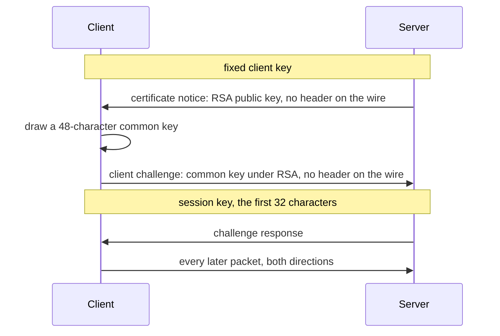

# Wire protocol

This page is for a reader about to judge a capture or a pattern: why a DDON connection of the PC client 03040008 looks the way it does, how a connection gets its key, why the first packet of each direction is special, what [nNetMsg](../reference/glossary.md#packets) adds on top of packets and why a RES is read behind a [guard](../reference/glossary.md#packets). You need nothing first; the bytes are in [Packet wire format](../reference/packet-wire-format.md).

## Transport

The client holds a TCP connection to a login server, then to a game server (ports 52100 and 52000 in the captures). Each connection has its own key and its own run of packets. Above TCP there is one framing, a big-endian length and a ciphertext, so one TCP segment may carry several packets and one packet may span segments. A reader of a capture therefore reassembles the stream and does not read segments. The same message shape serves both servers, and the two reuse ids, which is why a raw file's name prefix matters as much as its id.

## How a connection gets its key

The question this diagram answers is which key protects which packet; an arrow is one packet, in sending order.

The fixed key gives no secrecy: it is compiled into the client, so anyone holding a client reads the first two packets. The likely reason for it is that the framing and cipher path stay the same from the first byte (inferred). The secrecy rests on RSA, which wraps the common key. The server's private key is not in the captures, and only the official server ever held it.

The first packet has no header, and neither side needs one, since the two ends know what it must be. The client's send path drops the header its writer built, and its receive path makes one up for the dispatcher. The rest of the client then handles the certificate notice as an ordinary packet with a handler, under an id the wire never carries. A tool that treats every packet alike goes wrong at this point, and [the CLI patches](../reference/arrowgene-cli-patches.md) correct that.

## Why the session keys can be found at all

RSA would close the captures if the common key were random. It is not: each character is drawn from the client's global pseudo-random generator, an xorshift128 seeded once from a millisecond timer. So a key is a seed and a depth, both small for a client that has just started, and a candidate can be tested because the plaintext of the challenge response is known. That is the search [Decrypt a capture](../how-to/decrypt-a-capture.md) runs.

The same generator serves gameplay code on several threads without a lock. So the search works on the first login of a client process and fails on later ones: [RNG race](rng-race.md) explains why. Nothing else on this page depends on the race; it means only that some captured streams stay undecrypted.

## Why the plaintext has no length

The frame's length counts ciphertext, which comes in 16-byte blocks. A packet's own header holds no body size either, because the client's readers do not need one: each reader consumes exactly what its code says and stops. The consequence reaches every tool here. A file of decrypted bytes does not say where its body ends, and the padding after the body is whatever the buffer held, so it can look like data. Hence the weakness of the fit check, which [Packet decoding method](packet-decoding-method.md#what-a-fit-proves) takes up.

## nNetMsg: RPC inside packets

A handful of packets are carriers. The lobby and party binary packets hold a counted byte array, and in it a `cNetMsg` message addressed to a remote procedure object rather than to the connection. The client serializes one message into one stream and hands it to one send, so there is one message per packet and no record framing, and the array's `len` is its only length. A message's first field also selects the path: session 2 for the lobby, 0 for party binary.

This layer changes what a decode can prove. Because `len` states where the message ends, a pattern can test an exact end, which no ordinary packet allows. The PC widened several fields from their PS4 02020005 sizes (the RPC id and unique ids became u64), and the walk that shows it depends on that exact end.

## Why the RES guard exists

The client's RES readers read `s32 Error` and return unless it is 0. A pattern that follows the client must do the same, so it writes `s32 Error; if (Error == 0) { s32 Result; ... }`. Three things follow from that choice.

- **The layout of a failed RES is shorter.** A body read as if Error were 0 runs past the end of the packet, and the decode fails on a packet that is fine.
- **The JSON stays uniform.** Written inline in every RES, the guard gives every JSON a `packet.Error` and, on success, a `packet.Result`, with no shared structure to get wrong.
- **What a server writes after an error is not the format.** The captures of 18.0.2 show the official server writing Result and an empty list behind a non-zero Error, and the client never looks at them. Those bytes are decoded as unknown fields of that one packet, because the rule follows the reader and not the writer.

A peer might propose reading on regardless, since the server writes those bytes. The unpatched CLI does roughly that: its `ReadServerResponse` reads a short Result when Error is non-zero and the structures then read on. Every field after it comes out shifted, an empty list's count turns into a huge number, and parsing runs into the padding. The patched CLI stops after a non-zero Error for that reason. PS4 02020005 reads a u16 Error, a further reason not to carry the header across builds unchecked.

For some groups no captured RES takes the error branch, so there the guard rests on the code alone. [Packet open questions](../reference/packet-open-questions.md) names them.
