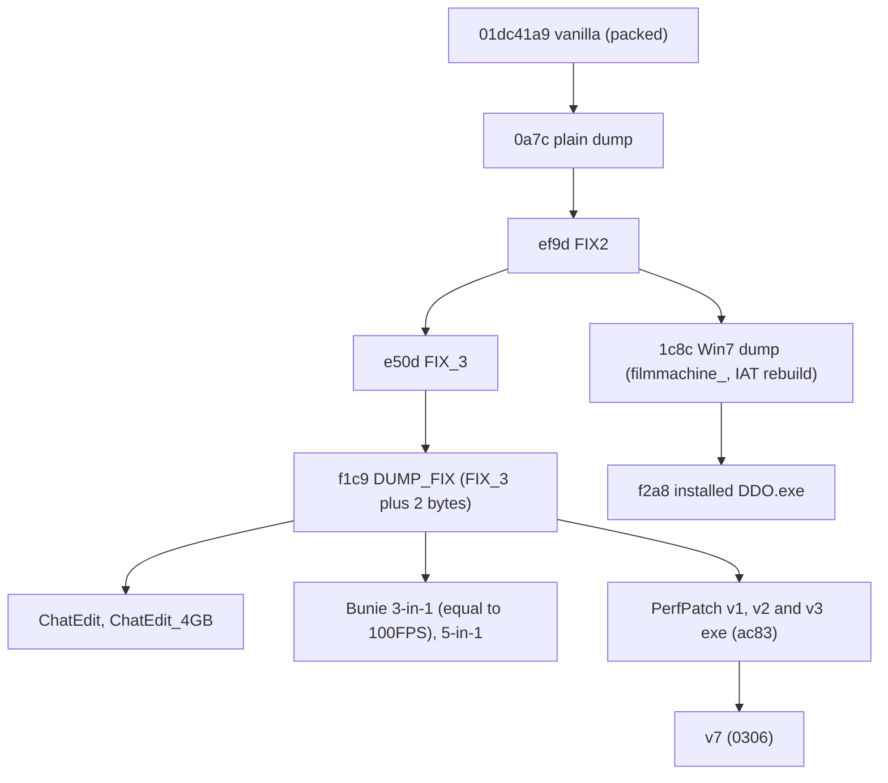

# Client patches

The hash chain of the Windows client executables, for anyone who must tell which executable they hold or which layer sits on which. It lists every recorded executable by SHA-256, the lineage between them, the file offsets of the dumps and the encoding of the `.r2` and `.json` files. To use a layer, see [Apply a client patch](../how-to/apply-a-client-patch.md); to record one, [Add a client patch layer](../how-to/add-a-client-patch-layer.md). Why the client looks like this: [Client lineage and protections](../explanation/client-lineage-and-protections.md).

Executables are named by the start of their hash (`f1c9`, `f2a8`). Every executable of the tables below is PC build 03040008 unless its row says otherwise. Lineage and per-layer sites were measured by a byte diff in `research/03040008/protections/R3-patches.md` §1 and §2.

## Vanilla Client Hashes

| Name | Version | SHA2-256 | Notes |
|------|---------|----------|-------|
| Dragon's Dogma Online Benchmark.exe | 0 | `93cb5d9377de1e45e79b0393df99d0dbb823a78c8348eb55327a9f6df9e64e8e` | |
| DDO.exe | 01010004 | `ef6ca484d217a2e01aa21e0756a215d77c88c324c78adc7438dee75d426ec853` | |
| DDO.exe | 02030004 | `b36a542d314e8b65b145ba4fb6f5c685bfc37fdb4895f4e414315f6bd4ff8a05` | |
| DDO.exe | 02030010 | `aaeb752a993050ffa2de71ebbfdd7f282490440447b703aa17e4d24b49acc51b` | |
| DDO.exe | 03040008 | `01dc41a962ea93a66b28bde36a9c61eec18d38e9d8d91cdb3139a0cb24c784f6` | Themida-packed; local copy `D:\DDON_03040008\DDO.exe.bak`. `DDO_v3.05.exe` is an older 2017 build, not this one (`research/03040008/protections/R3-patches.md` §1) |
| DDO_DUMP.exe | 03040008 | `0a7c5c637aeeaa7f308df25f119b8bb16350336b57edfd93d2db3a3e7dfe5f43` | Dumped 2020-04-26 with Scylla after finding OEP with relocation disabled |

## Patched executables

All binary diffs are `.r2` scripts with a `.json` beside them. Each row gives the hash a layer starts from and the hash it must produce.

### 2020–2022

| Name | Date | Publisher | Starting Hash | Patch | Target Hash | Notes |
|------|------|-----------|---------------|-------|-------------|-------|
| DDO_DUMP_FIX2.exe | 2021-05-01 | nothilvien | `0a7c5c637aeeaa7f308df25f119b8bb16350336b57edfd93d2db3a3e7dfe5f43` | `patches/2021_05_01_ddo_dump_fix2.r2` | `ef9d18154004e814dad18758fec7e0af7fb3408caa2d5ca72c1b0e41ce221bb7` | A dump with all crc checks disabled; you still need to use full scylla hide options, but the game should not crash anymore, and you can use HW and SW breakpoints, as well as save a modified version of it (for example: hardcoded the key generation to always generate AAAA...- key |
| DDO_DUMP_FIX_3.exe | 2022-01-03 | nothilvien | `ef9d18154004e814dad18758fec7e0af7fb3408caa2d5ca72c1b0e41ce221bb7` | `patches/2022_01_03_ddo_dump_fix_3.r2` | `e50dd5177212f44c2c6e58e3544a2e9e902a8c852921b364878b99842c9060b4` | |
| DDO_DUMP_FIX_MUTEX_E.exe | 2022-01-21 | nothilvien | `e50dd5177212f44c2c6e58e3544a2e9e902a8c852921b364878b99842c9060b4` | `patches/2022_01_21_ddo_dump_fix_mutex_e.r2` | `526bd9d23cf815ef013d0af4786591b84c3bc829842a73165c11b27700cf6129` | Changed the mutex string to _E. Because modding the mutex code will trigger a CRC error and close client. Allows to have a maximum of 3 clients active at the same time (original, _e and _f version) |
| DDO_DUMP_FIX_MUTEX_F.exe | 2022-01-21 | nothilvien | `e50dd5177212f44c2c6e58e3544a2e9e902a8c852921b364878b99842c9060b4` | `patches/2022_01_21_ddo_dump_fix_mutex_f.r2` | `c3db6f1952a847cf69e4171f709d2681ab9f5e1c792d8be6924c9839cf7e7485` | Changed the mutex string to _F. Because modding the mutex code will trigger a CRC error and close client. Allows to have a maximum of 3 clients active at the same time (original, _e and _f version) |
| DDO_DUMP_Mutex.exe | 2022-01-21 | nothilvien | `e50dd5177212f44c2c6e58e3544a2e9e902a8c852921b364878b99842c9060b4` | `patches/2022_01_21_ddo_dump_mutex.r2` | `9c9542a78fd548a174070e094447eef5fb00e3af8afb36060568cf9d0416c038` | Unlimited Instances |
| DDO_DUMP_FIX.exe | 2022-01-29 | nothilvien | `9c9542a78fd548a174070e094447eef5fb00e3af8afb36060568cf9d0416c038` | `patches/2022_01_29_ddo_dump_fix.r2` | `f1c974d0e529d4bb7dc5f0953d37eea6bbb023f2667f9a1d3a3b878f4919fa20` | Replays from the Mutex build but writes its 35 bytes back: the content is DDO_DUMP_FIX_3 (`e50d…`) plus 2 bytes, protector descriptor fields zeroed at `0x738B76` and `0xD5C79A`. No instance-limit removal (`research/03040008/protections/R3-patches.md` §2.5) |

### 2025

| Name | Date | Publisher | Starting Hash | Patch | Target Hash | Notes |
|------|------|-----------|---------------|-------|-------------|-------|
| DDO_ChatEdit.exe | 2025-05-29 | rootofallthings | `f1c974d0e529d4bb7dc5f0953d37eea6bbb023f2667f9a1d3a3b878f4919fa20` | `patches/rootofallthings_chat_edit.r2` | `31a30332010e7dd991043416102453b79db374621806a60b7c7092aec81f4041` | |
| DDO_Windows7Dumped_Mutex.exe | 2025-08-25 | filmmachine_ | `ef9d18154004e814dad18758fec7e0af7fb3408caa2d5ca72c1b0e41ce221bb7` | (none; re-dump with IAT rebuild, 9,085 bytes differ) | `1c8cc43a50cd28b669ce2ecd6ce1e90aba8752e53f354a0dffcdd36b4cf6c2f1` | Parent is DDO_DUMP_FIX2 by fewest differing bytes; carries none of FIX_3's or FIX's bytes (`research/03040008/protections/R3-patches.md` §1, §2.6) |
| DDO_DUMP_FIX_Patch3_Win7_Mutex_ChatEdit.exe | 2025-08-27 | techwomanwow | `1c8cc43a50cd28b669ce2ecd6ce1e90aba8752e53f354a0dffcdd36b4cf6c2f1` | `patches/techwomanwow_win7_chatedit.r2` | `f2a802295407f2d61669ad4a8a57abb938d6a5188d7ca588cc4d96b4496a8d74` | Built on the Win7 dump, so it has no FIX_3 bytes despite its name; the installed `D:\DDON_03040008\DDO.exe` |
| DDO_ChatEdit_4GB_RAM.exe | 2025-11-26 | mr.september | `f1c974d0e529d4bb7dc5f0953d37eea6bbb023f2667f9a1d3a3b878f4919fa20` | `patches/mr.september_chatedit_4gb_ram.r2` | `bf5107ef7ddf5f369d5d01267237f9a8def955b5a847c36264b9ed80230d8249` | The "4GB" write at `0x1B8` only rewrites the PE checksum: LARGEADDRESSAWARE is already set in the plain dump |

### 2026

| Name | Date | Publisher | Starting Hash | Patch | Target Hash | Notes |
|------|------|-----------|---------------|-------|-------------|-------|
| DDO_Bunie_3-in-1.exe | 2026-02-09 | bunie | `f1c974d0e529d4bb7dc5f0953d37eea6bbb023f2667f9a1d3a3b878f4919fa20` | `patches/bunie_3_in_1.r2` | `b9b9cf865012768e5a73bdff2b63318675b7974367cea4061880018dcf1d272e` | |
| DDO_Bunie_5-in-1.exe | 2026-02-18 | bunie | `f1c974d0e529d4bb7dc5f0953d37eea6bbb023f2667f9a1d3a3b878f4919fa20` | `patches/bunie_5_in_1.r2` | `268536f0e898060d1e65ad97c11801eddb1aaad97233d37a08692518bfb02dc5` | |
| DDO_Bunie_DDOPerfPatch_v1.exe | 2026-02-24 | bunie | `f1c974d0e529d4bb7dc5f0953d37eea6bbb023f2667f9a1d3a3b878f4919fa20` | `patches/bunie_DDOPerfPatch_v1.r2` | `ac836bcdfb6719bcefe7580c57f6b565f6915b689bde96bb8c988c185ffcbdeb` | |
| DDO_Bunie_DDOPerfPatch_v2.exe | 2026-02-25 | bunie | `f1c974d0e529d4bb7dc5f0953d37eea6bbb023f2667f9a1d3a3b878f4919fa20` | `patches/bunie_DDOPerfPatch_v1.r2` | `ac836bcdfb6719bcefe7580c57f6b565f6915b689bde96bb8c988c185ffcbdeb` | |
| DDO_Bunie_DDOPerfPatch_v3.exe | 2026-02-28 | bunie | `f1c974d0e529d4bb7dc5f0953d37eea6bbb023f2667f9a1d3a3b878f4919fa20` | `patches/bunie_DDOPerfPatch_v1.r2` | `ac836bcdfb6719bcefe7580c57f6b565f6915b689bde96bb8c988c185ffcbdeb` | v1, v2 and v3 share this exe; their `dinput8.dll` differ |
| DDO_Bunie_100FPSPatch.exe | | bunie | `f1c974d0e529d4bb7dc5f0953d37eea6bbb023f2667f9a1d3a3b878f4919fa20` | `patches/bunie_3_in_1.r2` | `b9b9cf865012768e5a73bdff2b63318675b7974367cea4061880018dcf1d272e` | Byte-identical to DDO_Bunie_3-in-1.exe |
| Bunie_PerfPatch_v7\DDO.exe | | bunie | `ac836bcdfb6719bcefe7580c57f6b565f6915b689bde96bb8c988c185ffcbdeb` | (none; 8 runs, 98 bytes) | `030623885f5af3a67e453ffdfbbd9dc26eb640c5bb4af25dac400b8920bc9f11` | Not Themida-packed. Its `dinput8.dll` (`8b60d64259d850e718b20e594f3f79a7d841d1d42be1e5db3275df5bf3151596`) hooks with MinHook (`research/03040008/protections/R3-patches.md` §2.10, §4) |

### A layer outside the index

`patches/` also holds `2026_10_17_ddo_dump_fix_4.r2` and its `.json`, not tracked at 2026-11-04 (other work):

| Name | Date | Starting Hash | Target Hash | Notes |
|------|------|---------------|-------------|-------|
| 2026_10_17_DDO_DUMP_FIX_4.exe | 2026-10-17 | `f1c974d0e529d4bb7dc5f0953d37eea6bbb023f2667f9a1d3a3b878f4919fa20` | `d38412ca6443540f1b22e766749f11b59e4239a6a43d4dbec55e85f2fa1cde84` | 33 bytes: the three checksum compares `0x24CD5DE`, `0x3A87F64`, `0x430DF3B` with the bytes of `1c8c`, and four `call [IsDebuggerPresent]` sites `0xBEEA24`, `0x19A7F4E`, `0x19AE2F1`, `0x19C1429` as `xor eax,eax` plus nops. Its `.json` adds `sites` and `validation`: three runs on 2026-10-17, of the compares alone, this layer, and this layer plus an `rdtsc` jump at `0x180DB03` that is not part of it. The hooked client crashed in all three, with `0xC0000005` at 46.9 s, 30.0 s and 26.2 s |

## Lineage

This diagram answers which executable each one was built from, by content; an arrow points from a parent to what was built from it. `f1c9` is `e50d` plus 2 bytes in content, though its `.r2` replays from the Mutex build `9c95`; `f2a8` descends from `ef9d` alone (`research/03040008/protections/R3-patches.md` §1).

The plain dump was made from the packed client with Ghidra, Scylla and others. Layers of 2020–2022 remove anti-tampering, anti-cheating and anti-debugging protections to enable research; layers from 2025 on improve quality of life.

| Layer | What it changes, by the publishers' lists |
| --- | --- |
| 2020–2022 | unpacked dump; CRC checks disabled; unlimited instances |
| 2025 | chatbox limit from 30 to 127 characters; application allowed 4 GB of RAM (the row of `bf51` says what that write does) |
| 2026 | up to 100 FPS in Borderless Windowed mode; shout message cooldown from 10 s to 5 s; hidden chat cooldown from 1 s to 0 s |

## File offsets of the dumps

Every dump-sized executable (68,231,680 bytes) has this section table, from `research/03040008/protections/R3-patches.md`. A `.r2` writes at file offsets; IDA and the pages give virtual addresses (VA).

| Section | VA range | File offset of VA start | VA = |
| --- | --- | --- | --- |
| header | `0x400000`–`0x4003FF` | `0x0` | off + `0x400000` |
| `.text` (game, first) | `0x401000`–`0x1AD4FFF` | `0x400` | off + `0x400C00` |
| `.rdata` | `0x1AD5000`– | `0x16D4000` | off + `0x401000` |
| `.data` | `0x2113000`– | `0x1D11A00` | off + `0x401600` |
| `.rsrc` | `0x220F000`– | `0x1D7BE00` | |
| `.reloc` (holds the IAT at `0x2233xxx` and protector code) | `0x2231000`–`0x240EFFF` | `0x1D9DC00` | off + `0x493400` |
| `.text#2` (captured SecureEngine image) | `0x240F000`–`0x45A3FFF` | `0x1F7B200` | off + `0x493E00` |
| `.SCY` (Scylla IAT store) | `0x45A4000`– | `0x410FE00` | |

## The `.r2` and `.json` files

| File | Form | Encoding |
| --- | --- | --- |
| `<layer>.r2` | a radare2 script of `wx <hex> @ <file offset>` commands, written by [`radiff2 -r`](https://book.rada.re/tools/radiff2/intro.html) | 10 of the 12 tracked are UTF-16LE with a BOM and CRLF; `rootofallthings_chat_edit.r2` and `bunie_5_in_1.r2` are UTF-8. radare2 6.1.0 runs only the UTF-8 ones: on a UTF-16 script it prints `Invalid command` and writes nothing ([what to do](../how-to/apply-a-client-patch.md#steps)), and `rg` and `sd` see NUL bytes in it. |
| `<layer>.json` | [`radiff2 -j`](https://book.rada.re/tools/radiff2/datadiff.html): `files`, two objects of `filename`, `size`, `sha256`, the parent first; `changes`, objects of `addr` (decimal file offset), `from`, `to` (hex bytes) | all 12 tracked are UTF-16LE with a BOM |

The `filename` values are the publisher's or the lab's names, so they differ from the Name column for several rows. All 12 tracked `.r2` files replay to their stated target hashes in an in-memory replay ([Status](status.md#client-patches)). The `.json` hashes of those 12 equal the two hash columns above ([Status](status.md#client-patches)).
