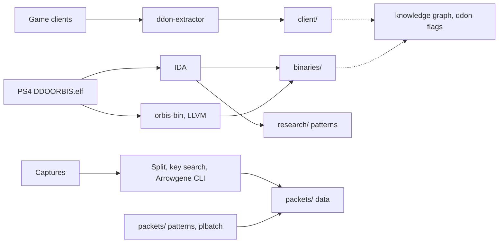

# Repository layout

Where everything is: each top path and each directory that matters under it, what it holds, who produces it and who reads it from outside. It is for anyone looking for a file or about to move one. Inputs that live outside the repository are on [Inputs and builds](inputs-and-builds.md).

## Top level

| Path | Holds | Produced by |
| --- | --- | --- |
| [`readme.adoc`](../../readme.adoc) | the overview | hand-written |
| [`AGENTS.md`](../../AGENTS.md), [`CLAUDE.md`](../../CLAUDE.md) | the canonical guide for coding agents; `CLAUDE.md` imports it | hand-written |
| `docs/` | this documentation: [the map](../index.md) | hand-written |
| `client/` | extracted client resources as JSON, and their summaries | [ddon-extractor](../how-to/extract-client-resources.md) |
| `binaries/` | disassembler exports and static dumps | IDA, `orbis-bin`, LLVM, Android tools |
| `packets/` | captured traffic, decoded; the patterns and engine that decode it | [`packets/README.md`](../../packets/README.md) |
| `patches/` | `.r2` patch scripts and `.json` metadata for PC `DDO.exe` builds | hand-written: [`patches/README.md`](../../patches/README.md) |
| `research/` | resource patterns, notes, research projects, external material | [`research/README.md`](../../research/README.md) |
| `specs/` | Spec Kit features of this repository, one directory each, with their briefs and evidence reports; closed ones are records | hand-written |
| `tools/` | the gate and the hooks: [`tools/README.md`](../../tools/README.md) | hand-written |
| `.claude/` | role agents, skills and the hook settings | hand-written |
| `.specify/` | Spec Kit 1.1.3 scripts, templates and the constitution | Spec Kit |
| `ddon-data.code-workspace`, `ddon-data-knowledge-graph.code-workspace` | editor workspaces | hand-written |
| `.agent-ledger/` | gate logs and the agents' tool-call ledger; gitignored | `tools/check.sh`, `tools/hooks/` |

## client

| Path | Holds |
| --- | --- |
| `client/03040008/` | about 173k JSON files mirroring `nativePC/rom` of client 03040008 |
| `client/03040008.csv` | every file: `Path,ArcPath,Ext,JamCrcStr,Class,JamCrc,Size,SizeCompress,Offset` |
| `client/03040008-resources.csv` | extension and class, with a `#extension,resource` header |
| `client/03040008-resources-exclusive.csv` | the extensions and classes of this client alone |
| `client/03040008-headers.csv` | an example file and the first bytes per extension |
| `client/03040008-extensions.txt` | the extensions, numbered |
| `client/03040008-area-masters.csv`, `client/03040008-layout-npc-location.csv` | derived lookups: area master ids and names; NPC ids, names and positions |
| `client/Benchmark.csv`, `client/Benchmark-resources.csv` | the same statistics of the benchmark client |

## binaries

| Path | Holds | Produced by |
| --- | --- | --- |
| `binaries/PS4_02020005/DDOORBIS.elf.h`, `binaries/PS4_02020005/DDOORBIS_1.elf.c` to `_3` | IDA export of `DDOORBIS.elf`, PS4 02020005: types and decompiled code, split for size | IDA 9.3 |
| [`binaries/PS4_02020005/elf-dumps/`](../../binaries/PS4_02020005/elf-dumps/README.adoc) | static dumps, one preferred source per category, with `manifest.jsonl`; `local/` and `archive/` are gitignored | [`generate-elf-dumps.sh`](../how-to/regenerate-elf-dumps.md) |
| `binaries/ANDROID_1500/` | decompiled Unity C# of the Android companion app, and `path_id_map.json` | AssetRipper, ILSpy |

## packets

[`packets/README.md`](../../packets/README.md) maps it. Only `decrypted_*`, `encrypted_streams/` and the `keys/` data are large.

| Path | Holds |
| --- | --- |
| `packets/encrypted_streams/`, `packets/keys/` | cleaned TCP streams; session keys and their script |
| `packets/decrypted_raw/`, `packets/decrypted_json/`, `packets/decrypted_annotated/` | decoded packets, per stream |
| `packets/patterns/03040008/` | ImHex packet patterns and `include/`, hand-written |
| `packets/plbatch/` | the batch engine of the export |
| `packets/tools/`, `packets/tests/`, `packets/wireshark/` | helpers, export tests, the dissector and display filters |
| `packets/*.sh`, `packets/*.txt` | the workflow scripts and the statistics |

## research

| Path | Holds | Produced by |
| --- | --- | --- |
| `research/03040008/r*-pattern.cpp` | ImHex resource patterns of client 03040008 | hand-written: [Decode a resource format](../how-to/decode-a-resource-format.md) |
| [`research/03040008/dumps/`](../../research/03040008/dumps/README.md) | the class table of the PC client's DTI | in-memory dump |
| [`research/03040008/xfs/`](../../research/03040008/xfs/README.md) | XFS files of client 03040008 as text and XML | hand-run conversions |
| [`research/03040008/notes/`](../../research/03040008/notes/README.md) | loose notes on quests and releases | hand-written |
| [`research/03040008/protections/`](../../research/03040008/protections/README.md) | evidence reports on the client's protections | hand-written |
| [`research/03040008/ida-transfer/`](../../research/03040008/ida-transfer/README.md) | the PS4 to PC annotation transfer: scripts and manifests | hand-written, its own runs |
| [`research/03040008/flags/`](../../research/03040008/flags/README.md) | `ddon-flags`, the quest and layout flag investigation, with `generated/` reports | that project |
| `research/knowledge-graph/` | `ddon-knowledge-graph`, a provenance-bound evidence graph (Neo4j, MCP) with its own Spec Kit project | that project |
| `research/ida/` | `private-copy.sh` and `decompile_func.py` | hand-written |
| [`research/pharos/`](../../research/pharos/README.md) | OOAnalyzer in Docker | hand-written |
| [`research/textures/`](../../research/textures/README.md) | DDS pattern and convert scripts | hand-written |
| [`research/rng-race/`](../../research/rng-race/README.md) | lab tools on why long-session captures do not decrypt | hand-written |
| [`research/scripts/`](../../research/scripts/README.md) | survey and validation scripts | hand-written |
| [`research/prompts/`](../../research/prompts/README.md) | LLM prompts for ddon-extractor | hand-written |
| `research/external/` | community spreadsheets and lists, as received | outside authors |
| [`research/external-references.md`](../../research/external-references.md), `research/external-references.jsonl` | the outside repositories and documents the research relies on | hand-written |
| `research/claude-vision-tokens.md`, `research/claude-vision/` | image token cost in Claude, and its counting script | hand-written |
| `research/PS4/`, `research/bbm/` | a PS4 launcher decompilation note; Bitterblack Maze map and stage links | hand-written |

Season 1 and Season 2 patterns are not here. They are in the sibling repositories: `ddon-data-s1/research/01020003/` and `ddon-data-s2/research/02030004/`.

## Sibling repositories

| Repository | Holds |
| --- | --- |
| [ddon-data-s1](https://github.com/ddon-research/ddon-data-s1), `D:\ddon-data-s1` | Season 1: client 01010004, its patterns in `ddon-data-s1/research/01020003/` |
| [ddon-data-s2](https://github.com/ddon-research/ddon-data-s2), `D:\ddon-data-s2` | Season 2: client 02030004, its patterns in `ddon-data-s2/research/02030004/`, `ddon-data-s2/recompilation/` (DWARF-based C++) |

## Data flow

Which input produces which tree, with an arrow from an input or tool to what it writes. The solid arrows are producers; the dotted ones are readers inside this repository.

The packet patterns and their engine live in `packets/` beside the data they produce. The steps are in [Extract client resources](../how-to/extract-client-resources.md), [Regenerate the ELF dumps](../how-to/regenerate-elf-dumps.md), [Decrypt a capture](../how-to/decrypt-a-capture.md) and [Export packets to JSON](../how-to/export-packets-to-json.md).

## What outside tools read

These paths stay put unless their reader changes with them. Searched on 2026-11-04 in the tracked files of each reader, outside its specs and data.

| Path | Reader | Where |
| --- | --- | --- |
| `client/03040008/` | ddon-explorer-server | `src/main/resources/application-dev.yaml:7` |
| `client/03040008/quest` | DDON-translation | `DDON-translation/Tools/Speaker_and_Quest_Text_Type_Filler.py:313`, `DDON-translation/Tools/last_archive_folder.txt:1` |
| `client/03040008-layout-npc-location.csv` | ddon-hook | `scripts/automation/stream49_constants.json:63`, a source note |
| `research/03040008/protections/README.md`, its §1 and §5 | ddon-hook | `AGENTS.md:57`; under `ddon-hook/docs/development`: `08:70`, `09:206`, `14:12`, `14:41`, `15:142`; `scripts/automation/run_cycles.py:614` |
| `research/external-references.md`, `research/external-references.jsonl` | ddon-hook | `AGENTS.md:84-85` |
| `research/claude-vision-tokens.md` | ddon-hook | under `ddon-hook/docs/development`: `11:113`, `13:91` |
| `research/rng-race/` (`ddonrng.py`, `race_model.py`, `pat2.json`, `cbcdec.exe`) | ddon-hook | `ddon-hook/tools/rng/timeline.py:48`, `corpus.py:50`, tests |
| `packets/keys/keys-all-in-one.csv`, `packets/keys/decrypt-pcapng-streams-all-in-one.sh` | ddon-hook | `ddon-hook/tools/rng/corpus.py:48`, `tear_search.py:819,901`, `test/core/domain/test_mt_random.cpp:23` |
| `binaries/PS4_02020005/elf-dumps/` (`README.adoc`, `manifest.jsonl`, `dwarf/inline-chains.orbis-addr2line.tsv`, `local/`, `archive/`, `ida/`) | the reconstructor | under `ddon-dwarf-reconstructor-rust/`: `AGENTS.md:8`, `docs/how-to/*`, `prerequisites.md:119` of its reference pages, `aba.sh` and `corpus_slot.sh` of its orchestration tools, `pgo_train.sh` of its release tools, `machine.py:26` of its LLM tool tests |

ddon-extractor, ddon-ghidra-scripts, ddon-data-s1 and ddon-data-s2 read nothing here by path. The Arrowgene documentation (`Arrowgene.DragonsDogmaOnline/docs/quests/generic_quest_state_machine.md:77`) links only the repository's root. [DDOn-Tools](https://github.com/alborrajo/DDOn-Tools) credits this research in provenance URLs of `rstagecustom*-season2-pattern` names, names that match no file in `ddon-data-s2/research/02030004/`, and reads no path here.

Inside this repository, these move only with their readers: `research/ida/private-copy.sh` (`tools/hooks/guard_ida.py`, `tools/check.sh`), `research/03040008/ida-transfer/` (`tools/check.sh`, `.gitignore`), `packets/plbatch/` and `packets/patterns/` (`packets/imhex-export.sh`, `tools/check.sh`), `research/03040008/flags/` (`src/ddon_flags/_paths.py`, by depth).
